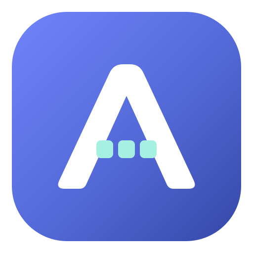
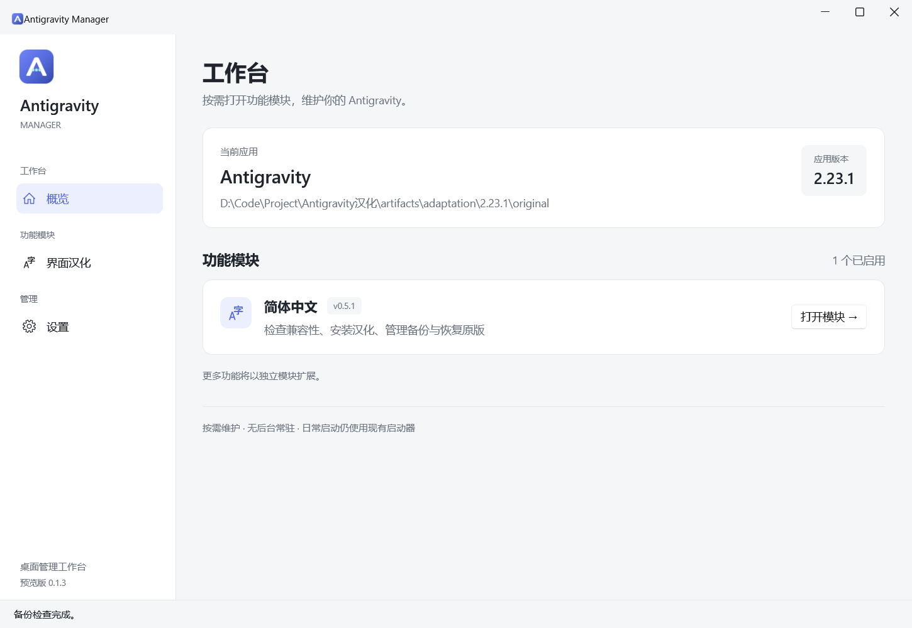

<div align="center">



# Antigravity Manager

**让 Antigravity 的日常维护更简单。**

Windows 桌面管理器 · 模块化功能 · 简体中文汉化


<a href="LICENSE"></a>

[快速开始](#快速开始) · [使用指南](docs/user-guide.md) · [开发文档](docs/development.md) · [文档中心](docs/README.md)

</div>

<br>

<picture>
  <source media="(prefers-color-scheme: dark)" srcset="docs/assets/screenshots/overview-dark.png">
  
</picture>

<p align="center"><sub>独立的维护工作台，支持明暗主题；截图使用隔离数据目录。</sub></p>

## 功能一览

Antigravity Manager 将维护操作集中在独立模块中。当前提供简体中文汉化模块，后续功能可通过统一接口接入。

| 界面汉化 | 版本检查 | 备份与恢复 |
| --- | --- | --- |
| 安装、修复汉化补丁，支持中英文切换 | 识别应用版本与文件指纹，区分可用和已安装补丁 | 按应用版本保存原始备份，校验后恢复 |

管理器提供操作记录、明暗主题和数据目录迁移。按需打开，维护完成即可关闭，日常启动继续使用原有快捷方式或代理启动器。

## 快速开始

**Windows x64 · ZIP 解压即用 · 无需另装 .NET 或 Node.js**

1. 获取 `AntigravityManager-<版本>-win-x64.zip`，完整解压。
2. 运行 `AntigravityManager.exe`，在“设置”中确认 Antigravity 安装目录。
3. 打开“界面汉化”检查兼容性，完全退出 Antigravity 后执行“安装／修复汉化”。
4. 按原有方式启动 Antigravity。需要撤销时，在“备份与恢复”中恢复原版。

源码下载不包含已编译程序。自行构建 ZIP 见 [打包与分发](docs/packaging.md)；首次配置和数据迁移见 [使用指南](docs/user-guide.md)。

### 当前支持

| 管理器 | 汉化补丁 | 已适配的 Antigravity |
| --- | --- | --- |
| **0.1.3** 预览版 | **0.5.1** | Windows **2.23.0 / 2.23.1** |

安装资格以已验证的文件指纹为准。应用更新后重新检查支持状态，具体范围见 [汉化模块指南](docs/modules/localization.md)。

## 开发

准备 Windows、.NET 10 SDK 和 Node.js，进入仓库根目录运行：

```powershell
./scripts/run.ps1
```

脚本会按需编译并启动桌面程序。只编译使用 `dotnet build AntigravityManager.slnx`，生成完整分发目录使用 `./scripts/publish.ps1`。环境、产物区别和测试步骤见 [开发指南](docs/development.md)。

## 文档与反馈

- **使用管理器**：[使用指南](docs/user-guide.md) · [汉化模块](docs/modules/localization.md)
- **参与开发**：[开发指南](docs/development.md) · [测试与验证](docs/testing.md) · [打包与分发](docs/packaging.md)
- **了解项目**：[项目架构](docs/architecture.md) · [更新记录](CHANGELOG.md) · [完整文档](docs/README.md)

反馈问题时请提供复现步骤、相关截图，以及管理器、补丁和 Antigravity 的版本。参与贡献前请阅读 [协作规范](AGENTS.md)。

## 许可证

本项目原创代码采用 [MIT 许可证](LICENSE)，允许商用、修改、分发及闭源使用，需保留版权和许可声明。第三方组件适用各自的许可证，清单与本地许可原文见 [第三方声明](THIRD_PARTY_NOTICES.md)。

---

<sub>本项目为独立的非官方工具，与 Antigravity 官方无隶属关系。第三方组件说明见 <a href="THIRD_PARTY_NOTICES.md">THIRD_PARTY_NOTICES.md</a>。</sub>
